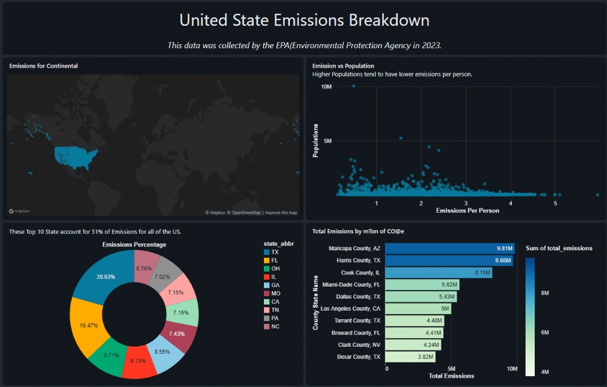

# US Greenhouse Gas Emissions Analytics | Databricks SQL

### An Interactive Environmental Data Analytics Project

An end-to-end SQL analytics and visualization project exploring greenhouse gas emissions across the United States using **Databricks SQL and AI/BI Dashboards**.

The project investigates geographic emission patterns, high-emission states and counties, and the relationship between population and emissions per person.

## Dashboard Preview



## Project Objectives

- Explore the geographic distribution of greenhouse gas emissions across the United States.
- Identify the top 10 states contributing to total emissions.
- Analyze counties with the highest reported emissions.
- Compare population levels with emissions per person.
- Present environmental data through interactive visualizations.

## Technology Stack

| Technology | Purpose |
|---|---|
| Databricks | Data analysis and dashboard development |
| Databricks SQL | Data querying and aggregation |
| Databricks AI/BI | Dashboard creation and visualization |
| SQL | Data transformation and analytical calculations |
| GitHub | Version control and project documentation |

## Dashboard Features

**1. Geographic Emissions Map**

Visualizes the geographic distribution of records using latitude and longitude.

**2. Emissions vs. Population**

A scatter plot examining the relationship between population and emissions per person.

**3. Top 10 States by Emissions**

A donut chart comparing the 10 highest-emission states.

**4. Top 10 Counties by Emissions**

A horizontal bar chart ranking counties by reported total emissions.

## SQL Skills Demonstrated

- Aggregation using `SUM()` and `GROUP BY`
- Data type conversion with `CAST()` and `TRY_CAST()`
- Data cleaning using `REPLACE()`
- Division-by-zero protection using `NULLIF()`
- Ranking and sorting with `ORDER BY` and `LIMIT`
- Creating reusable SQL datasets for dashboard visualizations

### Example: Top 10 States by Emissions

```sql
SELECT
    state_abbr,
    SUM(
        CAST(
            REPLACE(
                `GHG emissions mtons CO2e`,
                ',', ''
            ) AS DOUBLE
        )
    ) AS total_emissions
FROM emissions.default.emissions_data
GROUP BY state_abbr
ORDER BY total_emissions DESC
LIMIT 10;
```

## Key Analytical Observations

- **Emissions concentration:** The dashboard notes that the top 10 states account for approximately 51% of US emissions. This figure is displayed in the dashboard but has not been independently validated.
- **County-level differences:** The county ranking highlights Maricopa County, Arizona, and Harris County, Texas, among the highest reported values.
- **Population relationship:** The scatter plot explores whether more populated counties tend to have lower emissions per person.
- **Geographic patterns:** The map provides a visual overview of the locations represented in the emissions dataset.

## Data Source

The dashboard identifies the US Environmental Protection Agency (EPA) and references data collected in 2023.

The underlying source dataset, methodology, and reporting units should be verified and documented before treating the results as authoritative.

## Repository Contents

- `Emissions Dashboard.lvdash.json` — Exported Databricks AI/BI dashboard definition
- `screenshots/emissions-dashboard.png` — Dashboard preview
- `README.md` — Project overview and documentation

## Reproducing the Dashboard

1. Prepare the source emissions dataset in Databricks.
2. Create or configure the referenced table, `emissions.default.emissions_data`.
3. Import the `.lvdash.json` dashboard definition into a compatible Databricks workspace.
4. Update dataset queries and permissions as required.
5. Run the queries to populate the visualizations.

The dashboard export does not contain the underlying data.

## Future Improvements

- Add year-over-year emissions comparisons.
- Implement emissions intensity metrics and additional KPIs.
- Improve data validation and document source limitations.
- Add interactive filters for states and counties.
- Expand the analysis into a reproducible data engineering pipeline.

---

**Project Focus:** SQL Analytics | Data Visualization | Environmental Analytics | Databricks

*Created as part of a hands-on data analytics portfolio to demonstrate SQL querying, analytical thinking, and dashboard development.*
